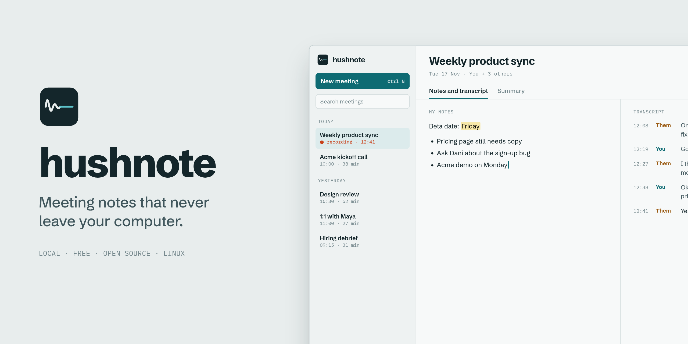
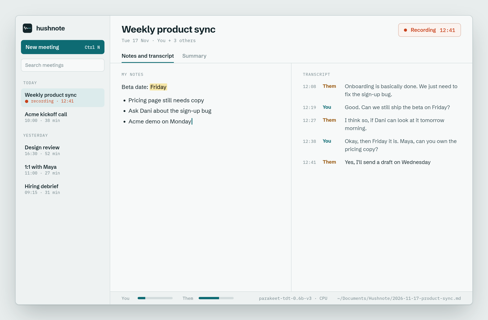
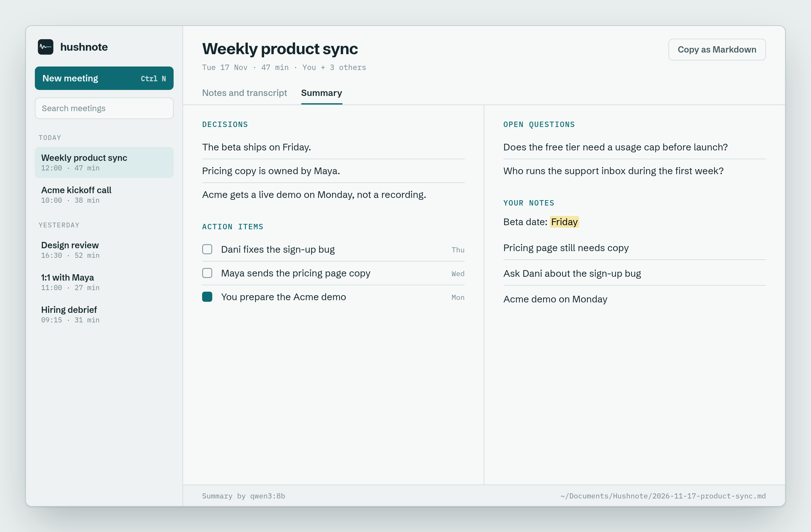

<p align="center">
  
</p>

<p>
  
  
  
  
</p>

# Hit record. Talk. Get the notes.

Hushnote listens to your meeting and gives you a clean write-up when it ends: what
was decided, who owes what, and what is still open. **Everything happens on your own
computer.** Your audio, your transcript and your summary never touch the internet.

No account. No subscription. Nobody training on your calls.

<br>

## Your meetings are confidential. Your notes tool should be too.

Most AI note-takers send your audio to a server, process it somewhere you cannot see,
and send a summary back. Your client calls, hiring chats and roadmap arguments end up
on someone else's machine.

Hushnote keeps all of it on yours. It works on a plane, in a basement, or under an NDA.

<br>

## See it work

**While the meeting runs**, you type your own notes and the conversation is
transcribed next to them, with timestamps and who said what.

<p align="center">
  
</p>

**When it ends**, you get decisions, action items and open questions, ready to copy.
Your own notes stay right beside them.

<p align="center">
  
</p>

<sub>These are design previews. The app is still being built, and the final screens may differ.</sub>

<br>

## What you get

**Both sides of the call.** Your microphone and the people you are talking to are
captured separately, so the transcript says who spoke.

**Live transcript.** Text appears as people talk. No more "wait, what did they just say?"

**Your notes plus the transcript.** Write what matters to you while the meeting runs.
Hushnote combines it with everything that was said and writes the summary around it.

**25 languages.** English, Spanish, French, German, Portuguese and more.

**Plain Markdown files.** Every meeting is one `.md` file in your Documents folder.
Open it in any editor, sync it with the tools you already use, keep it forever.

**Fast on ordinary hardware.** It uses your graphics card when there is one and runs
fine on the processor when there is not.

<br>

## Who it is for

- **Founders and freelancers** who talk to clients all day and cannot afford to miss a detail.
- **Managers** who are tired of writing a recap after every one-on-one.
- **Lawyers, consultants, journalists** and anyone whose conversations must stay in the room.
- **Everyone who hates typing notes** and would rather pay attention to the person talking.

<br>

## Hushnote vs. cloud note-takers

| | Typical cloud tool | Hushnote |
|---|---|---|
| Your audio is sent to a server | Yes | Never |
| Price | Monthly subscription | Free |
| Works offline | No | Yes |
| Account required | Yes | No |
| Where your notes live | Inside their app | Plain files you own |
| Source code | Closed | Open, MIT |

<br>

## Get started

Hushnote is an **early version** for **Linux**, with [Omarchy](https://omarchy.org) as
the main target. Expect rough edges and quick progress.

```bash
git clone https://github.com/SebastianV75/hushnote
cd hushnote
cargo build --release
```

A one-click installer is planned.

<br>

## Roadmap

- [ ] One-click installer
- [ ] Tell speakers apart by name
- [ ] Search across all your past meetings
- [ ] Tray icon and a global shortcut to start recording
- [ ] Import audio files you already have

Got an idea? [Open an issue](https://github.com/SebastianV75/hushnote/issues).

<br>

## Help it reach more people

If Hushnote sounds useful to you or your team, a star on this repo is the best way to
help. And if you know someone who dreads taking meeting notes, send them this page.

<br>

## Built with

[Rune](https://github.com/anomalyco/rune) for the interface, and
[transcribe-cpp](https://crates.io/crates/transcribe-cpp), the same local speech engine
behind [Hex](https://github.com/anomalyco/hex).

## License

MIT. Free for personal and commercial use.
