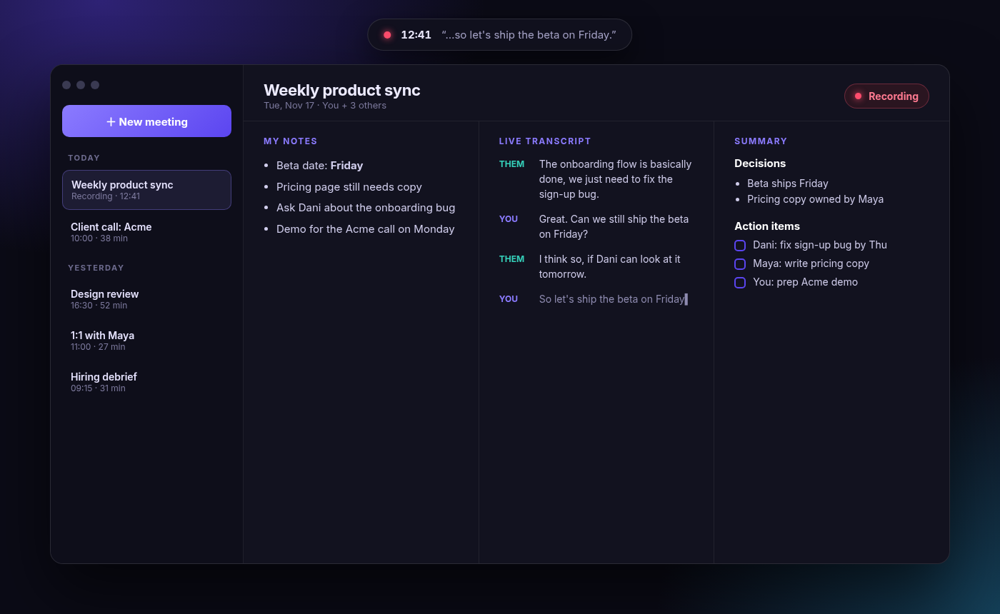
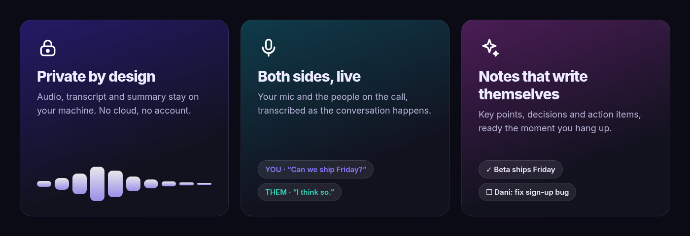
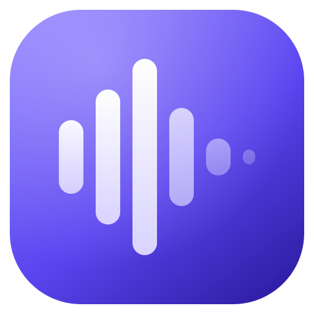

<p align="center">
  
</p>

<p align="center">
  <a href="LICENSE"></a>
  
  
  
</p>

<h3 align="center">Hit record. Talk. Walk away with clean notes, decisions and action items.<br>Not one word of your meeting leaves your machine.</h3>

<p align="center">
  <a href="#get-started"><b>Get started</b></a> ·
  <a href="#what-you-get"><b>Features</b></a> ·
  <a href="#why-hushnote"><b>Why Hushnote</b></a> ·
  <a href="#whats-coming"><b>Roadmap</b></a>
</p>

<br>

<p align="center">
  
  <br>
  <sub>Design preview: your notes, the live transcript and the summary, side by side.</sub>
</p>

<br>

## Your meetings are confidential. Your notes tool should be too.

Most AI note-takers work the same way: your audio goes up to a server, gets
processed somewhere you can't see, and comes back as a summary. Your client
calls, your hiring chats, your roadmap debates, all sitting on someone else's
computer.

**Hushnote does everything on your own machine.** The recording, the transcript
and the summary never touch the internet. No account. No subscription. No "we may
use your data to improve our models."

<br>

## What you get

<p align="center">
  
</p>

|  |  |
|---|---|
| 🎙️ **Just press record** | Captures your mic *and* the people on the call, so you get both sides of the conversation. |
| 📝 **Live transcript** | Watch the conversation turn into text as it happens. No more "wait, what did they just say?" |
| ✍️ **Your notes, plus ours** | Jot down what matters to you during the meeting. Afterwards, Hushnote blends your notes with the transcript into a clear summary: key points, decisions and who has to do what. |
| 🌍 **Speaks your language** | Understands 25 languages, including English, Spanish, French, German and Portuguese. |
| 📂 **Your notes are just files** | Every meeting is a plain Markdown file in your Documents folder. Open it anywhere, sync it with the tools you already use, keep it forever. No lock-in. |
| ⚡ **Fast on your hardware** | Uses your graphics card when it can, and still runs fine without one. |

<br>

## Who is it for?

<table>
<tr>
<td width="25%" valign="top"><b>🚀 Founders & freelancers</b><br><br>You talk to clients all day and can't afford to lose a single detail.</td>
<td width="25%" valign="top"><b>🧭 Managers</b><br><br>Tired of writing a recap after every one-on-one? Let it write itself.</td>
<td width="25%" valign="top"><b>⚖️ Lawyers, consultants, journalists</b><br><br>Conversations that are simply not allowed to leave the room.</td>
<td width="25%" valign="top"><b>🧠 Everyone else</b><br><br>Be fully present in your meetings instead of typing frantically.</td>
</tr>
</table>

<br>

## Why Hushnote?

| | Typical cloud note-takers | **Hushnote** |
|---|:---:|:---:|
| Your audio is sent to a server | Yes | **Never** |
| Monthly subscription | Usually | **Free** |
| Works offline | No | **Yes** |
| Account required | Yes | **No** |
| Notes are stored in | Their app | **Plain files you own** |
| Source code | Closed | **Open (MIT)** |

<br>

## Get started

> **Heads up:** Hushnote is in its **first early version**, built for **Linux**
> (with [Omarchy](https://omarchy.org) as the main target). Expect rough edges,
> and fast progress.

```bash
git clone https://github.com/SebastianV75/hushnote
cd hushnote
cargo build --release
```

Then press record on your next meeting. A one-click installer is on the way.

<br>

## What's coming

- [ ] One-click installer
- [ ] Telling speakers apart ("who said what")
- [ ] Search across all your past meetings
- [ ] Tray icon and a global shortcut to start recording instantly
- [ ] Import audio files you already have

Got an idea? [Open an issue](https://github.com/SebastianV75/hushnote/issues),
we'd love to hear it.

<br>

## Spread the word

If Hushnote sounds like something you or your team would use, **a ⭐ on this repo
is the best way to help it reach more people.** Tell a friend who hates typing
meeting notes. 🤫

<br>

## Built with

[Rune](https://github.com/anomalyco/rune) for the interface and
[transcribe-cpp](https://crates.io/crates/transcribe-cpp), the same local speech
engine behind [Hex](https://github.com/anomalyco/hex).

## License

MIT. Free for personal and commercial use.

<p align="center">
  
</p>
